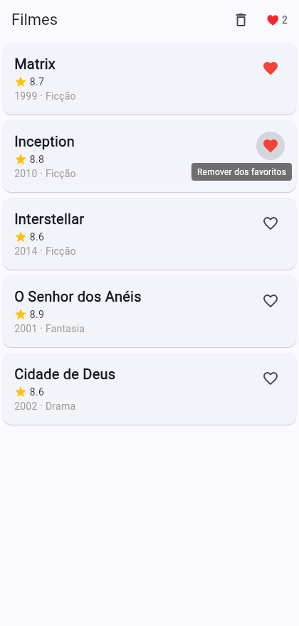

# Filmes (Flutter) — pratica/ da Atividade 3

App de catálogo de filmes em **Flutter**. Já roda; você completa os scaffolds (UI + estado) até `flutter test` ficar verde.

## Rodar
```bash
flutter pub get
flutter run -d chrome   # abre no navegador — sem emulador, sem rede/token
```

## Testar (é o gate da Atividade 3)
```bash
flutter test            # Ex1 (card) · Ex2 (favoritar/limpar) · Ex3 (seu teste) · checklist (auto-verificação)
flutter analyze         # precisa ficar limpo
```
Comece com os testes **vermelhos**; deixe-os **verdes**.

> `test/checklist_test.dart` é sua **auto-verificação** (não edite): tudo verde = você terminou.

## Por que `provider` > prop drilling?

Neste app o estado dos favoritos precisa aparecer em **três lugares ao mesmo tempo** — o coração
de cada `MovieCard`, o contador `♥ N` do header e o botão *limpar*. Passar o estado por parâmetro
(prop drilling) obrigaria o `HomeScreen` a declarar `favorites`, `onToggle`, `onClear` e repassá-los
para cada filho, e cada novo widget intermediário passaria a carregar esse peso — o acoplamento
cresce com a profundidade da árvore e qualquer novo ponto de exibição vira uma mudança em N
assinaturas. Com Riverpod, `favoritesProvider` é a **única fonte de verdade**: o card, o contador e
o botão fazem `ref.watch(favoritesProvider)` / `ref.read(favoritesProvider.notifier)` e pronto. Como o
estado é imutável (cada `toggle` cria um `Set` novo), o Riverpod sabe exatamente quem depende dele e
re-renderiza **só** esses widgets, o que também torna o estado trivialmente testável isoladamente
(`ProviderContainer`, sem UI) e evita re-renderizações desnecessárias da tela inteira. Em resumen:
o provider centraliza a fonte, elimina o encadeamento de parâmetros e mantém a UI declarativa.

## O que completar (🧑‍🏫 aula · 🧑‍💻 casa)
| TASK | Arquivo | O quê | |
|---|---|---|---|
| 1 | `lib/widgets/movie_card.dart` | compor o card (título + ⭐ nota + ano) | 🧑‍🏫 |
| 2 | `lib/state/favorites.dart` | `favoritesProvider` (`toggle` + `clear`) | 🧑‍🏫 |
| 3 | `lib/widgets/movie_card.dart` | coração favoritando (`ConsumerWidget` + `ref`) | 🧑‍💻 |
| 4 | `lib/screens/home_screen.dart` | contador `♥ N` no header | 🧑‍💻 |
| 5 | `lib/screens/home_screen.dart` | botão **limpar** favoritos | 🧑‍💻 |
| 6 | `test/favorites_test.dart` | **você escreve** um teste do provider | 🧑‍💻 |

Veja o `guia-passo-a-passo.md` (na pasta do exercício) e o `enunciado.md` (rubrica).

## Entrega



Validação local: 8 testes passaram, `flutter analyze` sem problemas e
`flutter build web` concluído. No Chrome, favoritar atualizou o contador e
o botão limpar zerou o estado.

Fork + PR no repo público; link no Canvas. O **J.A.R.V.I.S.** roda `flutter test` no seu PR.
- ✏️ **Edite os arquivos dentro de `exercicios/03-flutter-ui-estado/pratica/` (no lugar)** — **não crie subpasta** `aluno-.../`. O autograder roda `flutter test` nessa pasta.

> **Não comite** `.dart_tool/`, `build/`, `pubspec.lock` (já no `.gitignore`).
